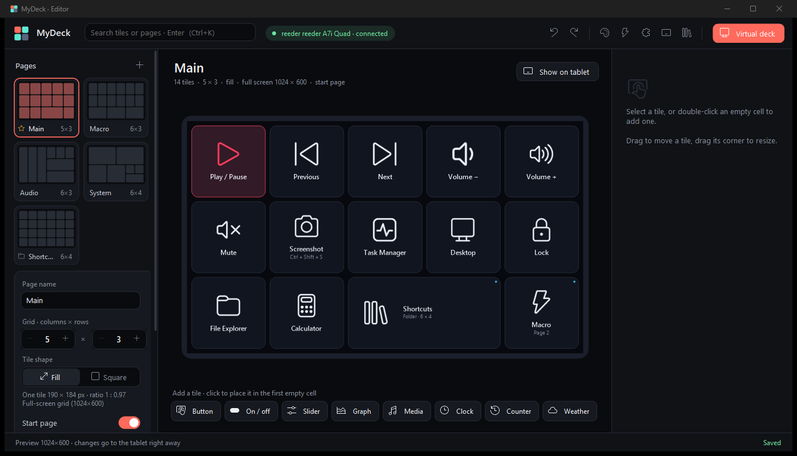
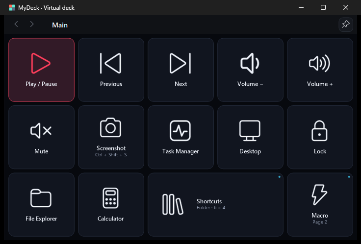

# MyDeck

MyDeck turns an Android tablet into a control panel for your Windows PC. You put tiles on a grid and each tile does something on the computer: open an app, press a shortcut, run a macro, change the volume of one app, show CPU temperature, control whatever is playing.

The tablet and the PC talk over your local network. Nothing goes through the internet.



## What you need

- A 64-bit Windows 10 (version 2004 or newer) or Windows 11 PC
- An Android tablet or phone running Android 5.1 or newer
- Both on the same Wi-Fi or local network

## Install

1. Download `MyDeck-Setup.exe` from the [latest release](https://github.com/harun-mutlu/MyDeck/releases/latest) and run it. It installs for your user only and doesn't need admin rights. If you'd rather not install anything, download `MyDeck-win-x64.zip` instead, unzip it anywhere and run `MyDeck.exe`.
2. The app isn't code-signed, so Windows may show "Windows protected your PC" the first time. Click **More info** and then **Run anyway**. Windows Firewall will then ask about network access; allow it on private networks.
3. On the tablet, open the browser and go to the address shown in the MyDeck window. Download and install the APK. Android may ask you to allow installs from the browser.
4. Open MyDeck on the tablet. It finds the PC by itself. The first time, both screens show a code; accept the connection on the PC if the codes match.

If the tablet can't find the PC (some routers block broadcast traffic), long-press the status screen on the tablet and type the PC's address by hand.

## Editing the deck

Click **Open editor** in the main window. Drag tiles around, pick an action on the right, and changes reach the tablet as soon as you save. The **Virtual deck** window shows the same deck on the PC, and you can use every tile there too.



Tile types:

- Buttons that open apps, files or websites, send key combinations, type text, or run a list of steps
- Sliders for the main volume, the microphone, or a single app
- Media tiles with cover art, play/pause and a seek bar
- Sensor graphs: CPU, GPU, RAM, disk, network. Temperatures and power need [HWiNFO](https://www.hwinfo.com/) running with shared memory turned on.
- Clocks, timers, stopwatches, calendar and weather (weather data from [Open-Meteo](https://open-meteo.com/))
- Folders and pages

Pages can switch on their own when a given program comes to the front.

## Plugins

A plugin is a folder with a `plugin.json` file and whatever scripts it needs, packed as a `.zip` or `.mydeckplugin` file. Install it from **Plugins** in the editor, or drop the file on that window.

```json
{
  "id": "ping",
  "name": "Ping",
  "description": "Shows the round-trip time to an address.",
  "version": "1.0",
  "author": "you",
  "data": [
    {
      "id": "ping",
      "name": "Ping",
      "command": "powershell -NoProfile -ExecutionPolicy Bypass -File ping.ps1 \"{address}\"",
      "seconds": 5,
      "fields": [ { "id": "address", "name": "Address", "default": "1.1.1.1" } ]
    }
  ]
}
```

`actions` entries run their command when a tile is pressed. `data` entries run every `seconds` seconds and the last line they print becomes the tile's value. If that line is JSON, these keys are read: `value`, `sub`, `color` and `percent` (0 to 1). `{field}` in a command is replaced with what the user typed into that field.

Plugins run commands on your PC with your permissions, so only install ones you trust. Two small examples are in [`samples/plugins`](samples/plugins).

Plugins made for other deck apps don't work in MyDeck.

## Updates

The PC app checks GitHub for a new release when it starts and every six hours after that. A new version is downloaded and installed by itself while MyDeck sits in the tray, or you can click the update button in the main window. You can turn automatic updates off in Settings. When the PC app has a newer tablet app inside, the tablet shows an update bar.

## Where things are stored

Settings, the profile and backups are in `%APPDATA%\MyDeck`. **Settings → Open data folder** takes you there. Uninstalling MyDeck from Windows Settings leaves this folder alone, so a reinstall picks up where you left off.

## Building from source

You need the [.NET 10 SDK](https://dotnet.microsoft.com/download). The Android tools are downloaded into the `tools` folder by the setup script, so nothing else is installed system-wide.

```powershell
.\scripts\setup.ps1      # JDK 17 and Android SDK into .\tools (asks you to accept the Android SDK licenses)
.\scripts\build.ps1      # tablet APK and PC app into .\out
.\scripts\release.ps1    # MyDeck-win-x64.zip and its .sha256 into .\dist
```

A build made this way uses the Android debug key, so its APK can't update a tablet that has the official app. Official releases are built and signed by GitHub Actions (`.github/workflows/release.yml`) when a `v*` tag is pushed.

`scripts\install-apk.ps1` installs the APK over USB if you'd rather not use the browser.

Ports: UDP 47800 for discovery, TCP 47801 for the connection, TCP 47802 for the APK download page.

## Feedback

Use **Send feedback** in the main window, or open an issue here.

## License

MIT
